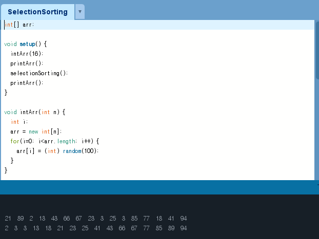
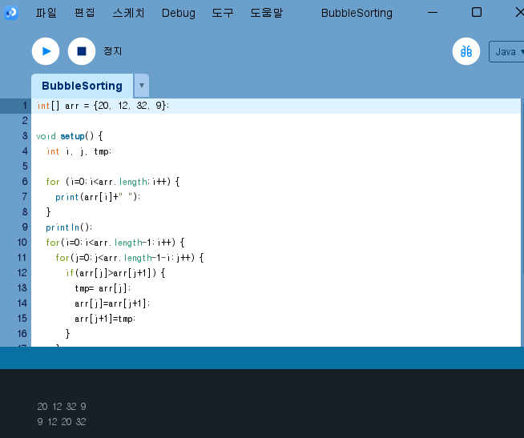
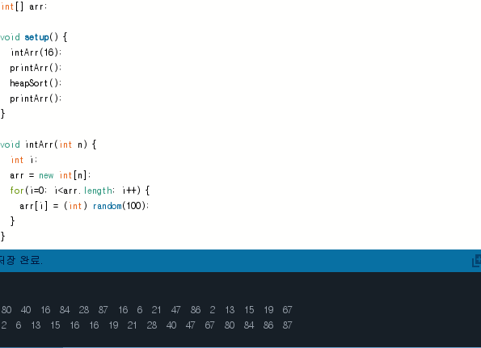
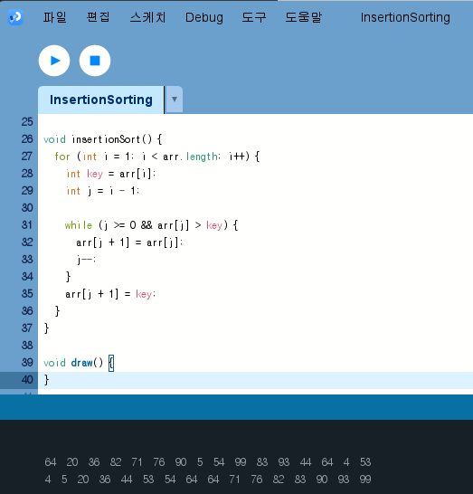
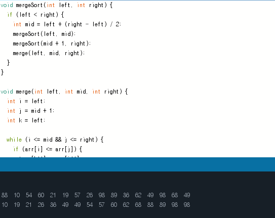
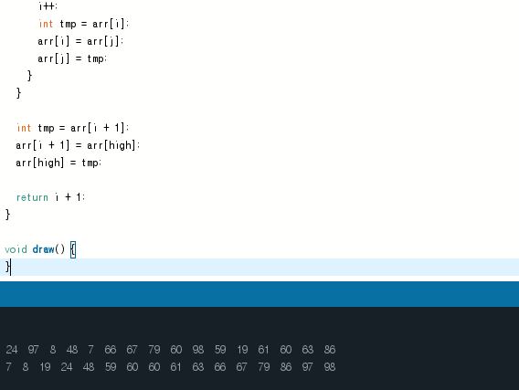
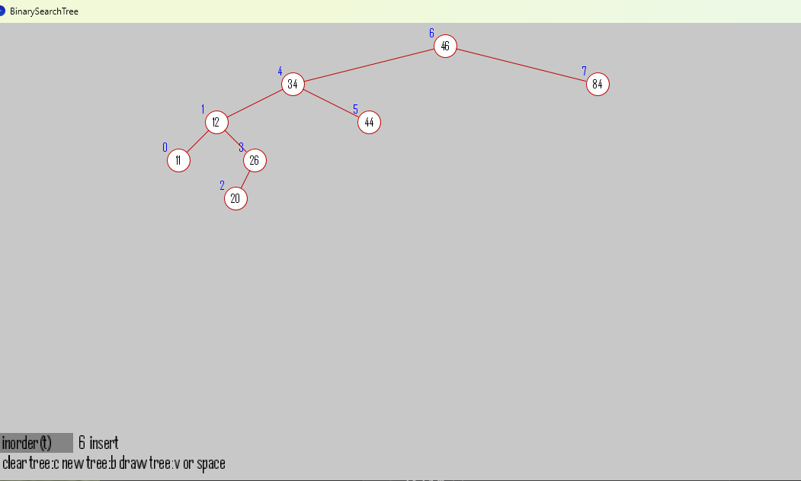
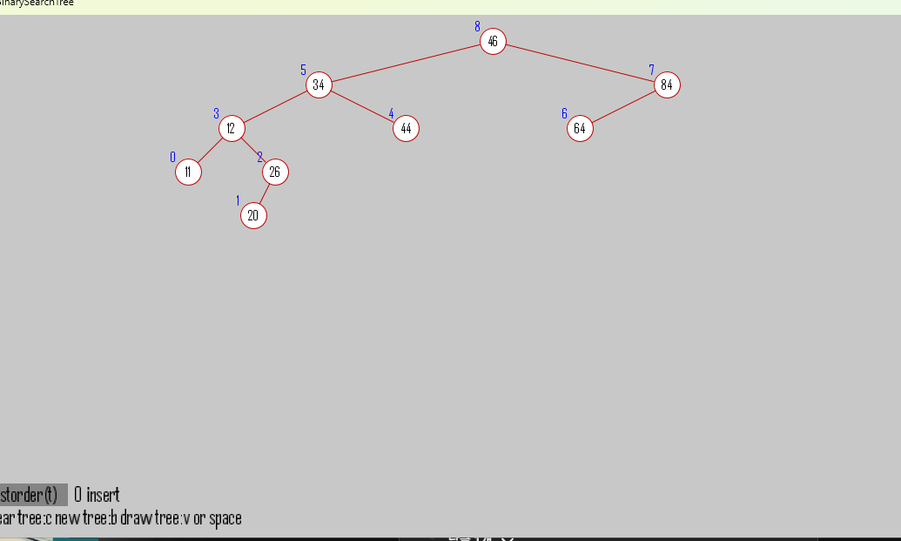
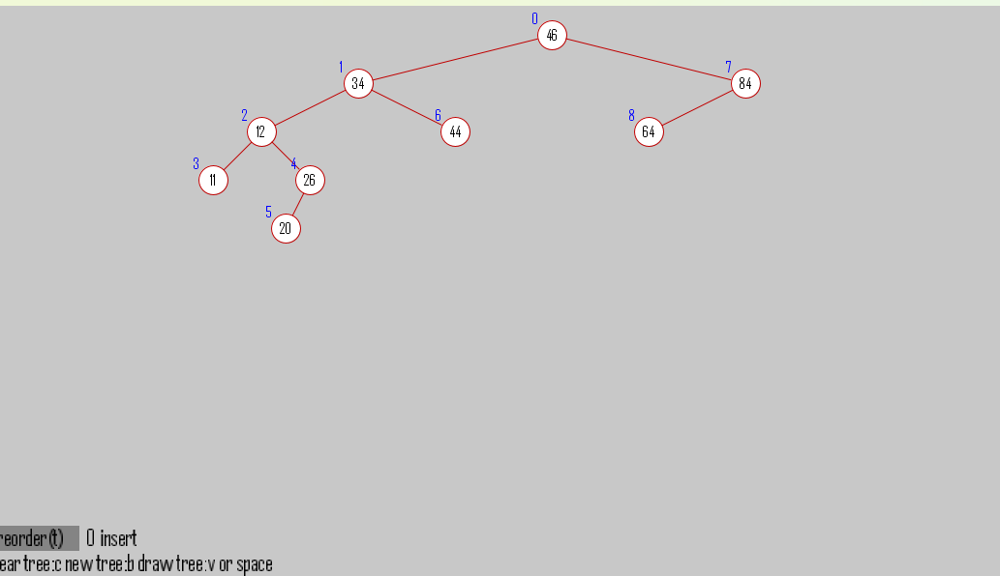

# Algorithm2026
### Homework1

[Selection Sorting 제출물](Homework1/SelectionSorting/SelectionSorting.pde)
 

 

### Homework2

[Bubble Sorting 제출물](Homework2/BubbleSorting/BubbleSorting.pde)
 

 
[Heap Sorting 제출물](Homework2/HeapSorting/HeapSorting.pde)
 

 
[Insertion Sorting 제출물](Homework2/InsertionSorting/InsertionSorting.pde)
 

 
[Merge Sorting 제출물](Homework2/MergeSorting/MergeSorting.pde)
 

 
[Quick Sorting 제출물](Homework2/QuickSorting/QuickSorting.pde)
 

 

### Homework3

[BinarySearchTree 제출물](Homework3/BinarySearchTree/BinarySearchTree.pde)
 

 

 

 

### Homework3

[SortAnimation 제출물](Homework4/SortAnimation/SortAnimation.pde)
 

 
[Sort Animation 유튜브 영상 보기](https://youtu.be/u98JXHCSA5E)

### Homework4

[Infix to Postfix 제출물](InfixtoPostfix/InfixtoPostfix.pde)
 

